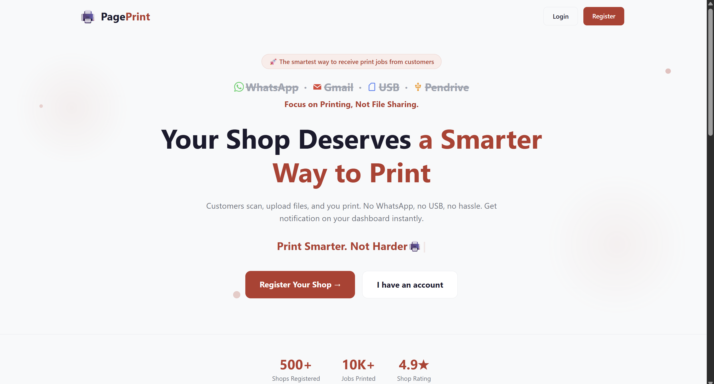
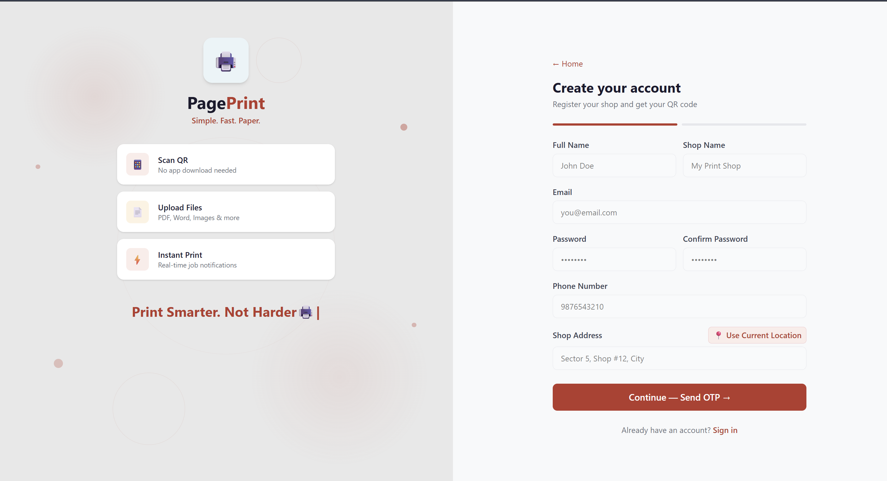
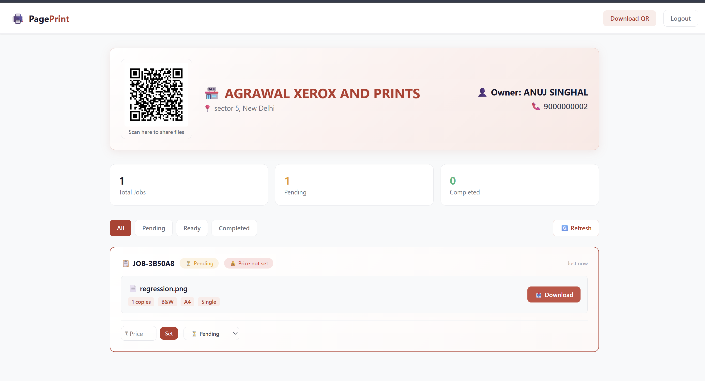
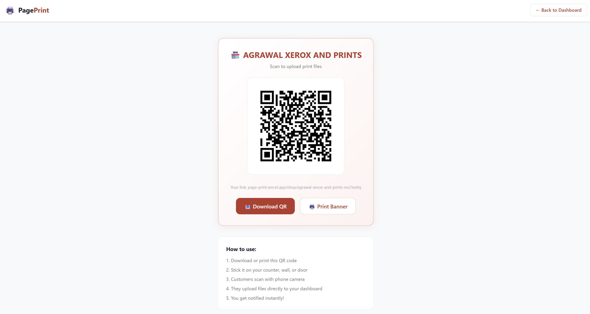
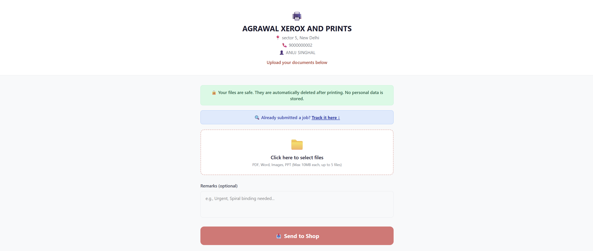
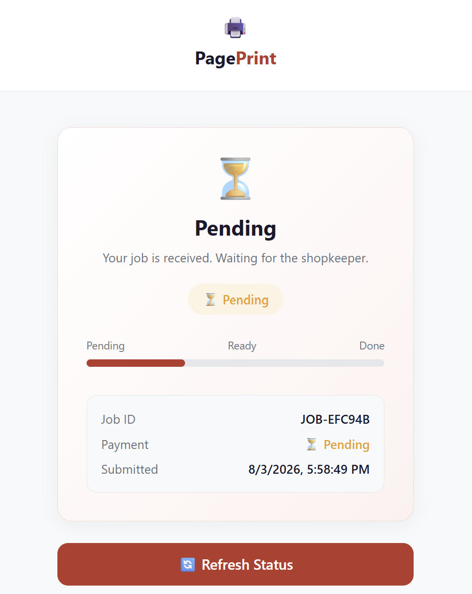

# 🖨️ PagePrint — QR-Based Print Job Management System

A full-stack web application that allows customers to upload documents to a print shop by scanning a QR code. Shopkeepers can manage print jobs, set prices, and track payments in real-time.

## 🌐 Live Demo

| Role | Link |
|------|------|
| 🏪 Shopkeeper (Dashboard) | [page-print.vercel.app](https://page-print.vercel.app) |
| 🛒 Customer (Upload Page) | [page-print.vercel.app/shop/agrawal-xerox-and-prints-ms7lva9q](https://page-print.vercel.app/shop/agrawal-xerox-and-prints-ms7lva9q) |

> **Note:** Backend is hosted on Render free tier — first request may take ~30s due to cold start.

## 📸 Screenshots

### 🏠 Landing Page

### 📝 Register Page

### 🏪 Shopkeeper Dashboard

### 📱 My QR Code

### 📤 Customer Upload Page

### 📋 Job Status Page

## ✨ Features

### 🏪 Shopkeeper Side
- QR code generation for shop
- Dashboard with real-time job notifications (Socket.IO)
- Download uploaded files
- Manage job status: Pending → Ready → Completed
- Set price, mark as paid

### 🛒 Customer Side
- Scan shop QR code → Upload documents instantly (no login required)
- Per-file print options: copies, color/B&W, paper size, single/duplex, page range
- Real-time job tracking via Job ID
- Files auto-deleted from cloud after 30 minutes for privacy

## 🛠️ Tech Stack

| Layer | Technology |
|-------|-----------|
| Frontend | React, Vite, Tailwind CSS |
| Backend | Node.js, Express 5 |
| Database | MongoDB, Mongoose |
| Real-time | Socket.IO |
| File Storage | Cloudinary |
| Auth | JWT, bcrypt, OTP (Nodemailer) |
| Deployment | Vercel (frontend), Render (backend) |

## 📊 Database Optimization

- **`.lean()`** — Skips Mongoose document hydration, returns plain JS objects
- **`.select()`** — Fetches only required fields, reduces payload
- **Compound Index** — `{ shopkeeper: 1, createdAt: -1 }` on PrintJob collection for fast dashboard queries
- Achieved **~74% faster** response times on 10,000+ records

## ⚡ API Endpoints

### Auth (`/api/v1/auth`)
| Method | Route | Description |
|--------|-------|-------------|
| POST | `/register` | Register shopkeeper |
| POST | `/send-otp` | Send OTP to email |
| POST | `/login` | Login shopkeeper |

### Customer (`/api/v1/customer`)
| Method | Route | Description |
|--------|-------|-------------|
| GET | `/shop/:shopSlug` | Get shop details |
| POST | `/create/:shopSlug` | Upload files & create job |
| GET | `/status/:jobId` | Track job status |

### Shopkeeper (`/api/v1/shopkeeper`)
| Method | Route | Description |
|--------|-------|-------------|
| GET | `/my-jobs` | Get all jobs (auth required) |
| PUT | `/update-status/:jobId` | Update job status |
| PUT | `/set-price/:jobId` | Set job price |
| PUT | `/mark-paid/:jobId` | Mark job as paid |
| GET | `/my-qr` | Get shop QR code |

## 👨‍💻 About Me

**Anuj Singhal**

MCA Student • NIT Jamshedpur

Backend-focused Full Stack Developer

## 📄 License

ISC
